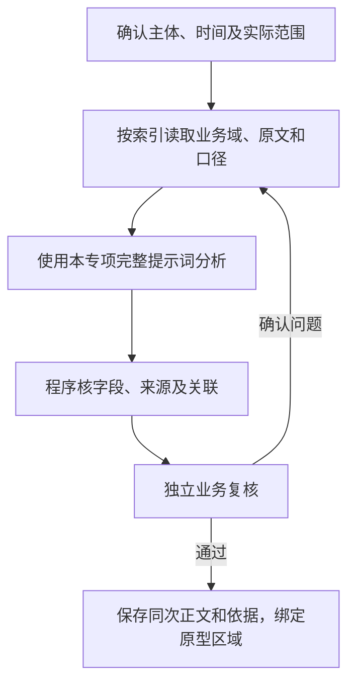

# 产品诊断AI策略

版本：V1（首次开发交付）。交付文件及阅读顺序见[开发交付说明](../README.md)。

## 1．总流程

共同事实和更新规则见共用策略。必要资料必须完整读取或明确受限；补查沿已核关系，不把目录中的字段当作已经接入的数据。

## 2．输入

### 2.1 任务范围

输入包含已核对的SPU档案、相关SKU/版本/项目、分析期间、分析截至时间、平台范围、尚未完成的建议及来源读取情况。候选资料分别保存，不能混入本品实绩；原期事实和后来进展分别标时间。

### 2.2 初始必取

| 索引路径 | 业务域字段/指标 | 返回要求 |
| --- | --- | --- |
| I-SPU及系统登记的SKU关系 | SPU型号/名称、品牌品类、生命周期、规格/版本、SKU、项目/供应商关系入口 | 只返回本品及分析必要的关联身份，不返回全部档案 |
| I-SPU→B01 | 任务期间及按口径确定的对照期GSV、销量、去退后销量、利润率/达成、各平台退货和系统提供的费用 | 标主体/平台/期间、原数据的统计层级、数据缺口，不能平均比例或分摊缺失SKU指标 |
| I-SPU→B02 | 对应目标、时间进度、达成/差额、评级与有效规则 | 目标不明不强算达成，考核期未结束不冒充最终评级 |
| I-SPU→B03 | 我司可售、在途、供应商侧可售/待检等组成、总库存、货值、库龄、库存天数、缺货/呆滞及备货建议 | 带快照时间、组成关系和所取字段定义；无批次推导，无父子重复汇总 |
| I-SPU→B11及诊断台账 | 相关计划/方案/报告、已安排工作、实际进展、尚未完成的建议及原依据 | 不把未提及当无人处理；同主体不同故障分开 |
| I-SPU及关联SKU/项目→B04/B05/B06/B07/B08/B10 | 分析期间新增/变更事件与当前未解决异常的简要清单：事件ID、类型、时间、现状、影响线索及明细入口 | 先读概览，再按问题取明细；独立安全、试验失败、采购供应异常等不能因经营指标尚正常而漏读 |
| 相关人员/岗位→B12 | 本品岗位、真实部门职责、现有承接及任职时间 | 只取与判断和建议有关的安排，姓名不明留空 |

### 2.3 按问题补取

| 补查路径 | 字段/指标 | 用途 |
| --- | --- | --- |
| SPU→SKU/供应商/项目→B04/B05/B06 | 采购量/交期/关闭/有效供价，项目三级灯色及任务，风险措施/执行/验证 | 核对供需、上市、交付与当前整改约束 |
| I-SPU→B07/B08 | SPU进线工单实际记录或汇总、问题分类及处理状态，差评/退货原因、检验复测、平台违规当前状态 | 进线工单按共用3.3节归属及去重，缺数据不补造；核实品质与用户问题，不从率值直接归责 |
| SPU/SKU/方案→B10 | 成本/渠道供价、方案基准/数量条件/费用/生效和确认、预计收益 | 比较降本、整改、供需调整、迭代或退出的实际取舍；测算与确认收益分开 |
| 相关店铺→B01/B08，相关主体→B11/B12 | 店内贡献/评分/链接/处置，历史转折和跨部门安排 | 仅补有系统记录或单据证明的关联涉及的记录，店铺与全产品贡献不混用 |

按当前主要矛盾提出补查需求，执行共用5.1节查询流程；依赖数据未取得时，只限定受影响判断。

## 3．提示词

[完整提示词](../02-提示词/02-诊断分析.md#11-产品诊断)。 无原建议时使用基础版本；有原建议使用[含原建议完整版本](../02-提示词/03-跟进与复核.md#11-产品诊断含原建议)，逐条更新原建议，不漏掉原标识。

## 4．输出字段

| AI返回字段 | 内容定义 |
| --- | --- |
| 经营结论 | 先用一句话说优先经营选择，再给关键量化理由及影响决定的条件，通常控制在200字左右。 |
| 问题分析 | 只按【具体问题标题】分述成立的经营问题，结合规格或平台、原因及已有措施效果；每项用一个短段，不重复整段结论。资料缺口附在它影响的判断后，不单独包装成经营问题。 |
| 部门行动 | 按【具体行动标题】分述主责下一步动作、必要协同和可验证结果，不展开通用检查清单。部门依真实职责选择，人员只写姓名，其归属显示由程序映射。 |

后台另返证据关联和重点片段，不增加正文栏目。

### 4.1 字色和加粗

| 语义类型 | 业务含义 | 程序展示 |
| --- | --- | --- |
| 核心结论 | 直接表达本次经营判断的关键句 | 普通字色加粗 |
| 决策 | 优先经营选择或动作短语 | 蓝色加粗 |
| 风险 | 有证据的异常事实或负向影响 | 红色加粗 |
| 关注 | 影响决定但尚待确认的事实或实施约束 | 紫色加粗 |
| 行动部门 | 建议承接的真实部门名称 | 紫色加粗 |

模型按“所属正文、原文片段、语义类型、出现次序”返回重点，出现次序指同片段在所属正文中的第几次出现，唯一出现填1；程序检查逐字位置后渲染。普通解释不整段强调，同一着色片段只用一种语义；成本下降等改善不能因为负号标红。标题按内容生成并统一加粗，模型不生成颜色或样式代码。

## 5．检查与更新

系统利润、测算与实际收益分开核，短期及较长可比期间结合判断。已有措施、实际结果和验证各自保存；原建议有新证据时更新，无变化保留原有效状态，已完成不再催办。人员只返回姓名及后台标识依据，部门和显示格式由程序处理。来源定位、三段正文和重点片段同次保存。
