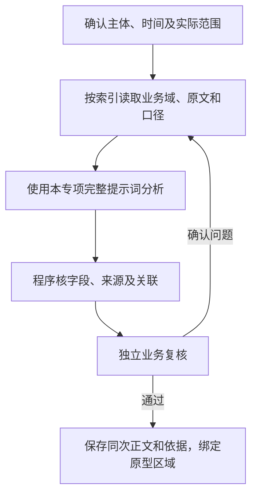

# 店铺诊断AI策略

版本：V1（首次开发交付）。交付文件及阅读顺序见[开发交付说明](../README.md)。

## 1．总流程

共同事实和更新规则见共用策略。必要资料必须完整读取或明确受限；补查沿已核关系，不把目录中的字段当作已经接入的数据。

## 2．输入

### 2.1 任务范围

输入包括平台、内部店铺主键/平台店铺ID、分析期间、分析截至时间、尚未完成的建议、店内商品/核心链接和真实岗位关系。名称不唯一时保留全部匹配，不推造商品归属；当前店铺入口有系统档案ID，材料候选仍须分别核对。

### 2.2 初始必取

| 索引路径 | 业务域字段/指标 | 返回要求 |
| --- | --- | --- |
| I-SHOP→B01 | 本店GSV、销量/去退后销量、利润与系统费用、退货、任务期间及按口径确定的对照期变化、店内商品贡献 | 店铺×平台×期间；没有按本店统计的数据不能用产品或平台总值代替 |
| I-SHOP→B02 | 本店适用目标、达成/差额、时间进度和有效配置 | 无适用目标明示，不强算达成 |
| I-SHOP→B08 | 最新可用评分及商品/物流/服务等实际分项，核心链接身份/原值/目标，违规类型、罚款/冻结、下架/掉权/限单/申诉及当前状态 | 各链接独立；事件金额次数与当前限制分开，标来源时点 |
| I-SHOP→B11及诊断台账 | 尚未完成的事项、相关报告、整改/申诉/经营安排、协同和处理进展 | 保留原事件身份，不重复催办已闭环事项 |
| 本店商品→B03/B04/B05/B06/B07/B08/B10 | 分析期间新增/变更事件与当前未解决异常的简要清单：事件ID、时间、状态、影响线索及明细入口 | 同时返回已核商品关联，关注有关供给、安全及品质异常 |
| 店铺岗位/人员→B12 | 店铺负责人及实际适用岗位、组织职责、任职时间、原单承接 | 具体人名有依据；作者转述与执行分开 |

### 2.3 按问题补取

| 补查路径 | 字段/指标 | 用途 |
| --- | --- | --- |
| 本店商品→SPU/SKU→B01/B07 | 店内商品贡献、同平台稳定期退货、差评/退货原因、检验故障及复测；关联SPU进线工单只作产品背景 | 区分店铺与产品范围，不把SPU工单归为本店工单，不用店铺整体退货率替代某SPU |
| 店内商品→SPU/SKU/供应商/项目→B03/B04/B05/B06 | 供给组成/库存天数、采购交期、任务灯色及日期、风险措施与验证 | 只作有关供给和项目背景，全SPU库存不自动当本店专属可用量 |
| 店铺/关联方案→B10，相关人员→B11/B12 | 费用基准、降本/追回/确认收益、现有分工及条件 | 评估影响和行动承接，有明确店铺归属才认定本店贡献 |

按共用5.1节在上述业务域内补查，验证要求也使用同一范围，不采集本店订单及仓配明细，不将这些明细作为建议验收前提。保留本店归属或明确关联路径；核心数据缺失时只给局部判断，不把个别链接或商品表现写成全店结论。

## 3．提示词

[完整提示词](../02-提示词/02-诊断分析.md#12-店铺诊断)。 无原建议时使用基础版本；有原建议使用[含原建议完整版本](../02-提示词/03-跟进与复核.md#12-店铺诊断含原建议)，逐条更新原建议，不漏掉原标识。

## 4．输出字段

| AI返回字段 | 内容定义 |
| --- | --- |
| 经营结论 | 本店当前经营判断、优先选择及关键现值和变化。 |
| 问题分析 | 按【具体问题标题】分述主要变化、商品或平台结构、原因依据、措施效果和影响决定的资料不足。 |
| 部门行动 | 按【具体行动标题】分述主责下一步动作、必要协同和可验证结果，不展开通用检查清单。依真实职责选择部门和人员，不固定部门数量；人员只写姓名。 |

后台另返证据关联和重点片段，不增加正文栏目。

### 4.1 字色和加粗

| 语义类型 | 业务含义 | 程序展示 |
| --- | --- | --- |
| 核心结论 | 直接表达本次经营判断的关键句 | 普通字色加粗 |
| 决策 | 优先经营选择或动作短语 | 蓝色加粗 |
| 风险 | 有证据的异常事实或负向影响 | 红色加粗 |
| 关注 | 影响决定但尚待确认的事实或实施约束 | 紫色加粗 |
| 行动部门 | 建议承接的真实部门名称 | 紫色加粗 |

模型按“所属正文、原文片段、语义类型、出现次序”返回重点，出现次序指同片段在所属正文中的第几次出现，唯一出现填1；程序检查逐字位置后渲染。普通解释不整段强调，同一着色片段只用一种语义；成本下降等改善不能因为负号标红。标题按内容生成并统一加粗，模型不生成颜色或样式代码。

## 5．检查与更新

系统利润、测算与实际收益分开核，短期及较长可比期间结合判断。已有措施、实际结果和验证各自保存；原建议有新证据时更新，无变化保留原有效状态，已完成不再催办。人员只返回姓名及后台标识依据，部门和显示格式由程序处理。来源定位、三段正文和重点片段同次保存。
