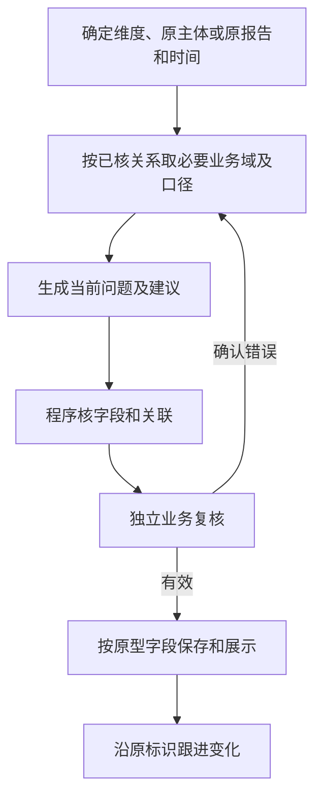

# 总诊断AI策略

版本：V1（首次开发交付）。交付文件及阅读顺序见[开发交付说明](../README.md)。

## 1．总流程

七个AI维度分别定义输入、判断与字段；日报未提交由程序处理，手工任务清单独立维护。业务诊断面向实际事项，报告诊断面向汇报表达及管理用途，不混用身份。

日期、灯色、榜名、主体名称、人员部门、来源和计数由程序处理。每次只使用当前维度完整提示词及本次实际资料，不带其他维度答案。无成立项、资料未齐、解析失败和分析失败分别保存；没有问题不凑数。

## 2．项目卡点

### 2.1 输入

| 读取方式 | 索引与业务域 | 所需字段/指标 | 用途与边界 |
| --- | --- | --- | --- |
| 必取 | I-PROJECT→B05 | 规则选定项目/阶段/任务ID、状态、三级有效灯色、计划/延期/实际日期、延期天数、任务负责人、完成情况及原问题 | 限定同一任务，原发现身份不随文案变化。 |
| 必取 | I-PROJECT→B06/B11 | 关联风险/执行单、处置事实、对应报告/交接/承诺、尚未完成的建议 | 区分未登记与实际未开展，核对已有安排。 |
| 必取 | 关联人员→B12 | 实际岗位职责、人员任职与承接关系 | 建议负责人有依据。 |
| 按需补取 | 项目→SPU/SKU/供应商→B03/B04/B07/B10 | 与卡点有关的库存供给、采购交期、检验复测、成本变更 | 只沿有系统记录或单据证明的关联取影响该任务的字段。 |

### 2.2 提示词

[完整提示词](../02-提示词/02-诊断分析.md#04-项目卡点)。

### 2.3 输出字段

| AI返回字段 | 内容定义 |
| --- | --- |
| 问题描述 | 通常用80—120字说清原计划、当前可靠状态及对哪个后续安排的影响。只保留改变判断的关键事实，源延期数、历史审厂记录及时间冲突的详细核对放依据。原因已确认就直接说明，不将所有问题改成待核实。 |
| 行动建议 | 每项通常用80—120字写【具体行动标题】、主责下一步动作、必要协同及交付结果。聚焦本轮最先要取得的关键结果，沿用有效分工；详细核对清单放依据，不整套复制原评审要求。 |
| 建议负责人 | 只返回最多1名有职责和事实依据的主责姓名，不能选定时留空；可承接的部门或岗位放建议。 |

后台关联单独返回：本次结果标识、输入原事项或来源标识、人员引用及角色、证据关联、读取范围和待核线索。已有事项沿用原标识；首次结果可用本批序号关联，不能冒充生产标识。人员引用只照录已给标识，注明实际参与、建议主责或建议协同；建议人员对应到本结果的具体行动标题，附参与或选人依据。
证据关联按共用要求返回并绑定本次结果标识。主表与后台按标识关联，不按返回顺序或相似标题猜配。
原项目、阶段、任务标识照录输入；后台另返跟进状态、进展与状态依据。

程序保留诊断日期、项目与任务名称、项目红绿灯、建议期限、更新日期和操作；建议负责人仅姓名，部门映射后显示。入选条件沿用进行中、项目阶段任务有效红灯、任务未完成且无关联风险/执行单。期限为有效首次发现日＋3个自然日，不因复核顺延。退出与处置完成分别保存。

## 3．新增高危

### 3.1 输入

| 读取方式 | 索引与业务域 | 所需字段/指标 | 用途与边界 |
| --- | --- | --- | --- |
| 必取 | 按榜单对象选I-SPU/I-SKU/I-SHOP→B08 | 本次规则已选事件ID、实际榜名、平台、榜单按SPU、SKU或店铺统计的对象、触发指标/目标/规则、本次及此前出现日、采集完整性 | 入选由程序保证，不能凭当前值补造首次日期。 |
| 必取 | 同主体→B11/B12 | 已明确处置、人员安排、相关报告及尚未完成的行动 | 不重复催办已完成处理。 |
| 按榜单取 | 同主体→B01/B02/B03/B07/B10 | 亏损取业绩/利润/成本，缺货呆滞取库存/天数/供给，退货取同平台稳定期及原因，店铺违规取当前限制及申诉 | 只取实际触发及判断所需指标，口径随字段返回。 |
| 按需补取 | 系统中已记录的关联→B04/B05/B06 | 供应交期、项目任务、整改验证 | 核实当前措施和剩余风险。 |

### 3.2 提示词

[完整提示词](../02-提示词/02-诊断分析.md#05-新增高危)。

### 3.3 输出字段

| AI返回字段 | 内容定义 |
| --- | --- |
| 问题描述 | 通常用1—3句说明本对象的核心问题、直接影响及必要进展；保留关键事实，详细核对放依据。包含本事件触发事实及当前变化，不堆所有未取得资料。 |
| 行动建议 | 按【具体行动标题】分述主责下一步动作、必要协同和可验证结果，不展开通用检查清单。 |
| 建议负责人 | 只返回最多1名姓名，无依据时留空。 |

后台关联单独返回：本次结果标识、输入原事项或来源标识、人员引用及角色、证据关联、读取范围和待核线索。已有事项沿用原标识；首次结果可用本批序号关联，不能冒充生产标识。人员引用只照录已给标识，注明实际参与、建议主责或建议协同；建议人员对应到本结果的具体行动标题，附参与或选人依据。
证据关联按共用要求返回并绑定本次结果标识。主表与后台按标识关联，不按返回顺序或相似标题猜配。
原事件标识照录输入；后台另返跟进状态、进展与状态依据。

程序保留原事件身份、主体、榜名和日期。本表无优先级与期限列。榜单＋对象＋平台去重，最近入榜第1天，第2—15天不重复，第16天起按既定规则形成关联事件；首次基线或历史不完整时不猜新增。

## 4．工作遗漏

### 4.1 输入

| 读取方式 | 索引与业务域 | 所需字段/指标 | 用途与边界 |
| --- | --- | --- | --- |
| 必取 | B11事项→任务指定的I-SPU/I-SKU/I-SHOP/I-SUPPLIER/I-PERSON/I-PROJECT→B11 | 应办依据、已确认计划/决议/承诺、要求日期、实际动作与结果、前后报告及尚未完成的事项 | 原文及处理范围完整；没写细节不能当未开展。 |
| 必取 | 关联项目/主体→B05/B06及相关业务域 | 原任务/风险/执行进度和对应经营、供给或品质事实 | 核实应做事项当前是否仍需要、是否已有实际落实。 |
| 必取 | 相关人员→B12 | 职责、任职、原单承接与协作关系 | 避免把转述者、无职责部门当遗漏责任。 |
| 按需补取 | 该事项关联→B01—B08及B10 | 实际影响、期限、费用、缺口或后续处理凭证 | 仅补与遗漏判断相关记录。 |

### 4.2 提示词

[完整提示词](../02-提示词/02-诊断分析.md#06-工作遗漏)。

### 4.3 输出字段

| AI返回字段 | 内容定义 |
| --- | --- |
| 业务对象 | 只列已匹配主体或全部有效候选的名称，解释放依据。 |
| 优先级 | 紧急、重要、一般；依据实际影响、期限和依赖判断。 |
| 问题描述 | 通常用1—3句说明本对象的核心问题、直接影响及必要进展；保留关键事实，详细核对放依据。 |
| 行动建议 | 按【具体行动标题】分述主责下一步动作、必要协同和可验证结果，不展开通用检查清单。 |
| 涉及人员 | 只返回直接相关实际参与人的姓名；建议主责与协同写在行动建议中，不混作实际参与。 |
| 跟进状态 | 按本任务四种状态判据取值；首次不明留空。 |

后台关联单独返回：本次结果标识、输入原事项或来源标识、人员引用及角色、证据关联、读取范围和待核线索。已有事项沿用原标识；首次结果可用本批序号关联，不能冒充生产标识。人员引用只照录已给标识，注明实际参与、建议主责或建议协同；建议人员对应到本结果的具体行动标题，附参与或选人依据。
证据关联按共用要求返回并绑定本次结果标识。主表与后台按标识关联，不按返回顺序或相似标题猜配。
主表只列本维度成立项，资料不足、合理推进和其他维度的问题不列预警、不赋优先级。无成立项时空主表并记录读取范围。

## 5．协同卡点

### 5.1 输入

| 读取方式 | 索引与业务域 | 所需字段/指标 | 用途与边界 |
| --- | --- | --- | --- |
| 必取 | B11事项→项目/人员/相关主体→B11/B12 | 交接内容、上游输出、下游要求、承诺日期、协作角色、沟通确认与已有安排 | 明确谁需要什么，避免把正常跨部门协作当卡点。 |
| 必取 | I-PROJECT→B05/B06或对应原单域 | 关联任务/执行单、依赖关系、实际进度和受阻证据 | 必须对应同一任务/交付，不以其他任务已完成抵消。 |
| 按需补取 | 关联SPU/SKU/供应商/店铺→B03/B04/B07/B10 | 物料/数量/交期、测试复测、报价/费用或决策条件 | 为本次衔接提供具体可交付和验收条件。 |

### 5.2 提示词

[完整提示词](../02-提示词/02-诊断分析.md#07-协同卡点)。

### 5.3 输出字段

| AI返回字段 | 内容定义 |
| --- | --- |
| 业务对象 | 只列已匹配主体或全部有效候选的名称，解释放依据。 |
| 优先级 | 紧急、重要、一般；依据实际影响、期限和依赖判断。 |
| 问题描述 | 通常用1—3句说明本对象的核心问题、直接影响及必要进展；保留关键事实，详细核对放依据。 |
| 行动建议 | 按【具体行动标题】分述主责下一步动作、必要协同和可验证结果，不展开通用检查清单。 |
| 涉及人员 | 只返回直接相关实际参与人的姓名；建议主责与协同写在行动建议中，不混作实际参与。 |
| 跟进状态 | 按本任务四种状态判据取值；首次不明留空。 |

后台关联单独返回：本次结果标识、输入原事项或来源标识、人员引用及角色、证据关联、读取范围和待核线索。已有事项沿用原标识；首次结果可用本批序号关联，不能冒充生产标识。人员引用只照录已给标识，注明实际参与、建议主责或建议协同；建议人员对应到本结果的具体行动标题，附参与或选人依据。
证据关联按共用要求返回并绑定本次结果标识。主表与后台按标识关联，不按返回顺序或相似标题猜配。
主表只列本维度成立项，资料不足、合理推进和其他维度的问题不列预警、不赋优先级。无成立项时空主表并记录读取范围。

## 6．缺少方案

### 6.1 输入

| 读取方式 | 索引与业务域 | 所需字段/指标 | 用途与边界 |
| --- | --- | --- | --- |
| 必取 | B11问题→任务指定的I-SPU/I-SKU/I-SHOP/I-SUPPLIER/I-PERSON/I-PROJECT→B11/B06 | 问题、已有措施/备选、关键条件、责任安排、结果及验证、尚未完成的行动 | 先识别已存在的方案和合理验证。 |
| 必取 | 同主体/原任务→B05或相关业务域 | 目标/实际差距、约束、方案所需资源或技术/交付条件 | 判断措施是否对应问题、是否可执行。 |
| 必取 | 相关部门/人员→B12 | 职责边界、已确认承接及协同 | 建议与实际职责匹配。 |
| 按需补取 | 关联主体→B01/B02/B03/B04/B07/B10 | 效果、需求/供给、成本收益、试验和方案条件 | 可自主比较实际有意义的路径，不要求固定备选数量。 |

### 6.2 提示词

[完整提示词](../02-提示词/02-诊断分析.md#08-缺少方案)。

### 6.3 输出字段

| AI返回字段 | 内容定义 |
| --- | --- |
| 业务对象 | 只列已匹配主体或全部有效候选的名称，解释放依据。 |
| 优先级 | 紧急、重要、一般；依据实际影响、期限和依赖判断。 |
| 问题描述 | 通常用1—3句说明本对象的核心问题、直接影响及必要进展；保留关键事实，详细核对放依据。 |
| 行动建议 | 按【具体行动标题】分述主责下一步动作、必要协同和可验证结果，不展开通用检查清单。 |
| 涉及人员 | 只返回直接相关实际参与人的姓名；建议主责与协同写在行动建议中，不混作实际参与。 |
| 跟进状态 | 按本任务四种状态判据取值；首次不明留空。 |

后台关联单独返回：本次结果标识、输入原事项或来源标识、人员引用及角色、证据关联、读取范围和待核线索。已有事项沿用原标识；首次结果可用本批序号关联，不能冒充生产标识。人员引用只照录已给标识，注明实际参与、建议主责或建议协同；建议人员对应到本结果的具体行动标题，附参与或选人依据。
证据关联按共用要求返回并绑定本次结果标识。主表与后台按标识关联，不按返回顺序或相似标题猜配。
主表只列本维度成立项，资料不足、合理推进和其他维度的问题不列预警、不赋优先级。无成立项时空主表并记录读取范围。

## 7．资源错配

### 7.1 输入

| 读取方式 | 索引与业务域 | 所需字段/指标 | 用途与边界 |
| --- | --- | --- | --- |
| 必取 | B11安排→任务指定的I-PERSON/I-PROJECT/I-SPU/I-SHOP/I-SKU/I-SUPPLIER→B11/B12 | 已确认优先事项、人员分工、实际投入/排期、组织职责、批准调整、尚未完成的事项 | 报告频次不是投入量，角色不同不等于错配。 |
| 必取 | 关联主体→B02/B05/B06 | 实际业务目标/进度、关键依赖、风险与资源约束 | 说明哪个重点受到什么影响。 |
| 按需补取 | 关联主体→B01/B03/B04/B07/B10 | 经营/供给/质量/交付影响、费用/收益和已有替代安排 | 有证据才比较机会成本，不编工时、预算和投资回报。 |

### 7.2 提示词

[完整提示词](../02-提示词/02-诊断分析.md#09-资源错配)。

### 7.3 输出字段

| AI返回字段 | 内容定义 |
| --- | --- |
| 业务对象 | 只列已匹配主体或全部有效候选的名称，解释放依据。 |
| 优先级 | 紧急、重要、一般；依据实际影响、期限和依赖判断。 |
| 问题描述 | 通常用1—3句说明本对象的核心问题、直接影响及必要进展；保留关键事实，详细核对放依据。 |
| 行动建议 | 按【具体行动标题】分述主责下一步动作、必要协同和可验证结果，不展开通用检查清单。 |
| 涉及人员 | 只返回直接相关实际参与人的姓名；建议主责与协同写在行动建议中，不混作实际参与。 |
| 跟进状态 | 按本任务四种状态判据取值；首次不明留空。 |

后台关联单独返回：本次结果标识、输入原事项或来源标识、人员引用及角色、证据关联、读取范围和待核线索。已有事项沿用原标识；首次结果可用本批序号关联，不能冒充生产标识。人员引用只照录已给标识，注明实际参与、建议主责或建议协同；建议人员对应到本结果的具体行动标题，附参与或选人依据。
证据关联按共用要求返回并绑定本次结果标识。主表与后台按标识关联，不按返回顺序或相似标题猜配。
主表只列本维度成立项，资料不足、合理推进和其他维度的问题不列预警、不赋优先级。无成立项时空主表并记录读取范围。

## 8．日周月报问题诊断

### 8.1 输入

| 读取方式 | 索引与业务域 | 所需内容 | 用途与边界 |
| --- | --- | --- | --- |
| 必取 | B11原报告及采集元数据 | 原报告身份、类型、原工作日期/期间、部门汇报或个人报告、报告所属部门、作者及任职关系、来源部门文件夹；正文、表格、图表、已引用附件和未读范围 | 先知道报告表达了什么。部门按明确归属或已配置部门文件夹取得，未知姓名不抹掉部门 |
| 必取 | 原报告→B11陈述索引 | 关键数字及统计范围、实际进度、计划/承诺、管理结论、引用依据及原文位置 | 陈述是待核内容，不等于已成立的报告问题；按实际汇报粒度理解 |
| 按报告范围取 | 报告作者/所属部门→B12；报告事项→B05/B06/B11 | 已确认职责、本期应汇报的重要任务/变化、相关上期计划及承诺、可用模板或汇报要求 | 判断重点与衔接须有依据；不能把部门全部工作都认定每份报告应写 |
| 针对陈述补取 | 已匹配I-SPU/I-SKU/I-SHOP/I-SUPPLIER/I-PERSON/I-PROJECT→相关已定义业务域 | 与被核数字、状态、结论或计划直接相关的指标、原单、验收、实际进展及有效安排 | 先核同主体/事项、期间、层级、口径和获知时间，不以当前快照倒判原报告失实 |
| 必取 | 原报告诊断及更正关系→B11 | 原报告已指出的表达问题、待澄清要求、原依据、后续补充/更正及解释 | 更新的是报告问题，不是该报告所述全部业务风险的整改进度 |

按需从以下方向审阅，不要求每份报告逐项产出问题：

| 方向 | 核验重点 |
| --- | --- |
| 事实与数据准确性 | 数字勾稽、统计口径/时间、状态表达是否一致，是否与可比原始记录相符 |
| 进度表达清晰度 | 动作、结果、当前阶段及待办是否讲清，是否混淆计划、申请、执行和验收 |
| 结论依据 | 完成、有效、达标、原因等结论是否得到报告及可回查资料支持，是否超出证据 |
| 重点覆盖 | 有职责、计划或汇报要求支持的重要变化是否漏报；完整阅读及核实重要性后才能判断遗漏 |
| 后续衔接 | 上期承诺、本期结果、未完成原因及下一步安排是否衔接，是否存在有影响的矛盾或脱节 |

日报侧重当期动作、结果和次日衔接；周报侧重阶段目标、重点进展及跨周承诺；月报侧重目标达成、趋势原因、措施效果及后续取舍。按实际职责、汇报要求和周期判断，不强制固定模板、字数、评分或每条必须齐备全部要素。

### 8.2 提示词

[完整提示词](../02-提示词/02-诊断分析.md#10-日周月报诊断)。

### 8.3 输出字段

主表定义：
| AI返回字段 | 内容定义 |
| --- | --- |
| 问题说明 | 每份有确认问题的报告一条；按【具体报告问题标题】分述具体缺陷及管理影响。 |

详情定义：
| AI返回字段 | 内容定义 |
| --- | --- |
| 诊断项 | 一种独立报告问题的简短名称，不按所含产品数量重复拆同一问题。 |
| 问题说明 | 原报告表达、已核对照、具体缺陷和需要澄清或更正的内容。 |
| 对应原文 | 目标报告相关片段、原文位置、表头及必要上下文；外部对照放证据关联，不冒充目标报告原文。 |

每条主表和详情在后台附内部报告关联，值只填输入原报告ID；详情用本报告内的问题序号对应主表问题，不能按姓名、顺序猜归属。首次问题保留原文定位，新生产标识由程序生成。
无确认问题只在后台保存内部报告关联、审阅结论和读取范围，不进问题主表；待核线索单列。证据关联另存，本次不生成历史跟进表。

## 9．日报未提交

输入为B12截止时应交组织/人员快照、B11对应工作日的日报身份和实际提交/补交记录。应交范围与共用策略一致，业务日期D的日报截止D＋1日09:00，北京时间，提交时间不晚于截止时间视为按时。范围和提交记录未完整同步时标核对受限，不生成确认欠交，不调用AI。

以人员ID＋原工作日期保存欠交记录，部门使用截止时归属；补交更新“是否已补交”，原记录、应交时间和业务日期保留。查询按原工作日期，后来的组织变更不倒写历史；不自行增加节假日或请假免交规则。若存在无法确认工作日期或报告类型的日志，受影响人员/日期先记待核，不能直接算欠交或已补交。

输出字段为人员 / 部门、报告类型、工作日期、应交时间、是否已补交；报告类型固定日报。是否补交按源记录输出是/否，无法核实按页面说明展示，不以查询无正文认定“否”。

## 10．保存与跟进

按共用策略步骤七执行。业务旧项用14完整提示词逐条更新，报告旧问题用15逐条核对；新报告仍用10单独审阅，按原报告及问题标识去重。前端字段和输入／输出责任见[原型字段逐列对照.md](../03-开发参考/开发接入说明.md)。
