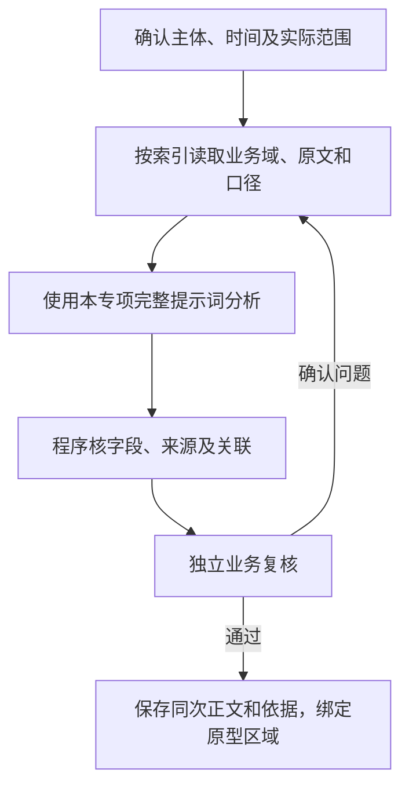

# 部门项目风险根因分析AI策略

版本：V1（首次开发交付）。交付文件及阅读顺序见[开发交付说明](../README.md)。

## 1．总流程

共同事实和更新规则见共用策略。必要资料必须完整读取或明确受限；补查沿已核关系，不把目录中的字段当作已经接入的数据。

## 2．输入

| 读取方式 | 索引路径 | 业务域字段/指标 | 返回要求 |
| --- | --- | --- | --- |
| 必取 | B12部门→B06→I-PROJECT | 来源系统、风险单ID、项目ID、责任部门/链主、问题类别/描述/原根因、纠正/预防、发生/期限/整改/验证日期、风险灯色、整改/验证状态、原始凭证 | 部门全部风险，包含已闭环；完整分页，列出实际范围及缺口 |
| 必取 | I-PROJECT→B05 | 项目状态/灯色、计划/延期/实际日期、延期天数、阶段任务、完成及依赖、关联风险/执行单 | 区分项目四灯与风险单三灯，不由延误推灯色 |
| 必取 | 关联事项→B11/B12 | 问题原因原文、处理/交接/方案/验证、人员职责和承接关系 | 分组依据可回查；不把报告空字段当根因 |
| 按需补取 | 项目→已匹配的SPU/SKU/供应商→B03/B04/B07/B10 | 供给交期、检验故障、成本方案及相关条件 | 只补与原因判断或措施效果有关的字段，不输入全部经营历史 |
| 程序统计 | 当前查询范围全体项目/风险→B05/B06 | 未闭环关联项目、项目红灯/高危判断、全范围红灯风险与部门关联 | 供指标和计数计算；与用于分组的全量集合区分，不让模型重算 |

先按页面适用的项目范围、日期和品牌确定分析范围，再读取这些项目下本部门全部风险，包含所有灯色及已闭环记录，不受台账分页、所选根因组或状态筛选缩小。输入保留部门、截至时间、完整风险单ID列表及缺口；成员按来源系统＋项目ID＋风险单ID区分。

风险逐单的原因核验结果可按风险原文、关联处理、时间及角色依赖缓存，改变的成员重核，合并时仍读取全部当前成员。风险较多时分两步处理：先按批读取每张风险的完整问题、原原因、措施和凭证入口，提出原因分组；再合并各批有相同实际原因的组，并补查存在争议的原单。合并后以完整风险单ID列表检查覆盖和重复，不能只拼各批TOP3，也不能只凭标题相似合组。关键批次缺失时不发布一套声称全量的TOP3，沿用原有效结果并说明缺口。

原报告用于补充原单原因及处理经过；已生成的AI分组不能作为原因依据。

## 3．提示词

[完整提示词](../02-提示词/02-诊断分析.md#13-部门项目风险根因)。

## 4．输出字段

原因组表：
| AI返回字段 | 内容定义 |
| --- | --- |
| 稳定组标识 | 每组有且只有一条；与成员引用一致，已有组有变化时保留稳定标识及对应关系。 |
| 原因标题 | 用一个简短原因短语，通常8—16字；不写产品、受影响节点、处理办法或进展。频繁、普遍等程度有实际依据。 |
| 根因简述 | 用一句短句解释原因本身，通常20—40字；说清什么条件未满足、哪项内容未确认或哪个环节发生变化。只解释已成立的原因；待核关系和证据范围限定留在成员依据。不要再接导致延期、影响推进等后果，不写具体产品、日期、措施或进展。 |

成员表：
| AI返回字段 | 内容定义 |
| --- | --- |
| 稳定组标识 | 归入一个主要原因组或待核集合，必须能对应原因组或明确的待核集合。 |
| 原风险标识 | 照录输入；每张风险有且只有一条成员记录，全部成员数＝已分组且不重复成员数＋待核成员数。 |
| 对应证据及待核原因 | 每条用一句说明归因依据或具体待核原因，引用原单相关短句及位置。原状态、措施、时间和完整原文由程序按标识读取，不整段复抄；复合分支仅说明影响本次主因选择的差异，不借其他单补齐。 |

返回全部有依据的原因组和完整成员。原风险根因、状态、责任及措施不被分组覆盖，排名和风险数、项目数由程序计算。

## 5．程序统计

1. 全部风险单数量＝已分组且不重复的风险单数量＋暂时无法确定主要原因的风险单数量。同一风险单只能计入其中一项。每张风险单在本部门只计入一个主要原因组，多因边界在成员证据说明，简述只解释本组原因；成员不能遗漏或重复计算。
2. 表现相同的问题可能原因不同，原因不明保留待核。没有普遍性证据不把一个个案扩成部门通病；单个案例可保留为个案原因组，但不能声称反复发生。已闭环作为原因与措施效果的证据，不重复安排整改；组内同时有未完成和已闭环风险时分别说明，不用已闭环个案证明全组都已解决。
3. 程序按组内不重复的风险单数量降序、涉及项目数降序及稳定组标识排序取TOP3，不足3组不凑数。组内风险和项目数量包括本次实际分组的已闭环成员，不冒充待整改数量。点击组名按同一组内的风险单列表回查；标题不是原风险ID，不覆盖原单根因/措施/责任。组名调整不使原风险丢失，保存的组标识与成员用于回查。
4. 红灯项目为本部门未闭环风险关联的红灯项目去重数；高危项目为其中按系统有效规则识别的高危项目。红灯风险占比分子为责任部门包含本部门的未闭环红灯风险单数，分母为当前全景查询范围的未闭环红灯风险单总数；全局分母按来源系统和原风险单标识去重。分母0显示“—”。
5. 未闭环指尚未完成整改或尚未通过闭环验证；整改完成但待验证仍属未闭环，不把“已整改”直接当“已闭环”。同一风险/项目可以关联多个部门，各部门独立计数，不能将部门数直接相加当全局唯一数。项目四灯、风险单三灯、台账当前状态（待整改/整改中/已整改）、闭环验证（待验证/已验证）分别使用，不能替换成总诊断四种跟进状态。

## 6．保存与更新

按原风险标识保存完整分组成员和证据。标题和简述只说原因，具体产品、影响、措施与验证放成员依据；原台账不覆盖。源数据或分组规则变化只重算受影响范围。
