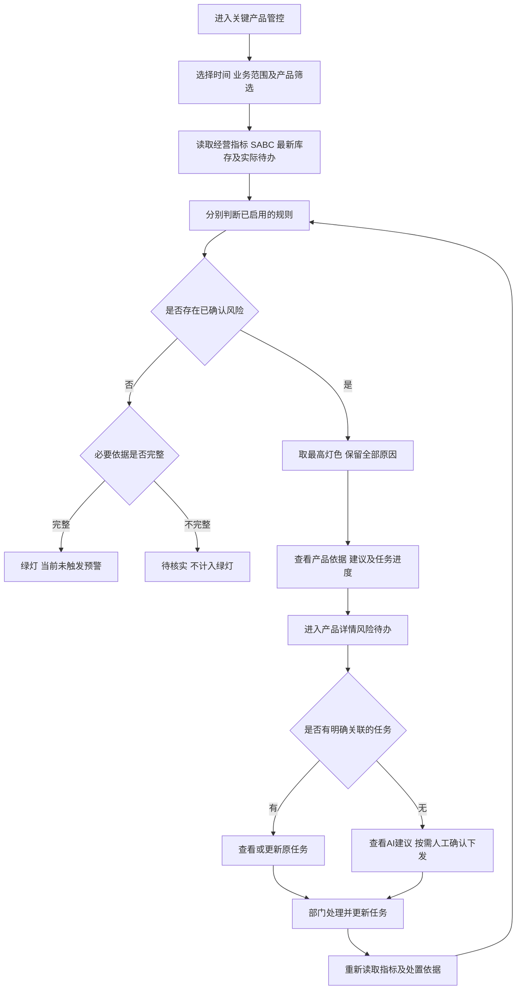
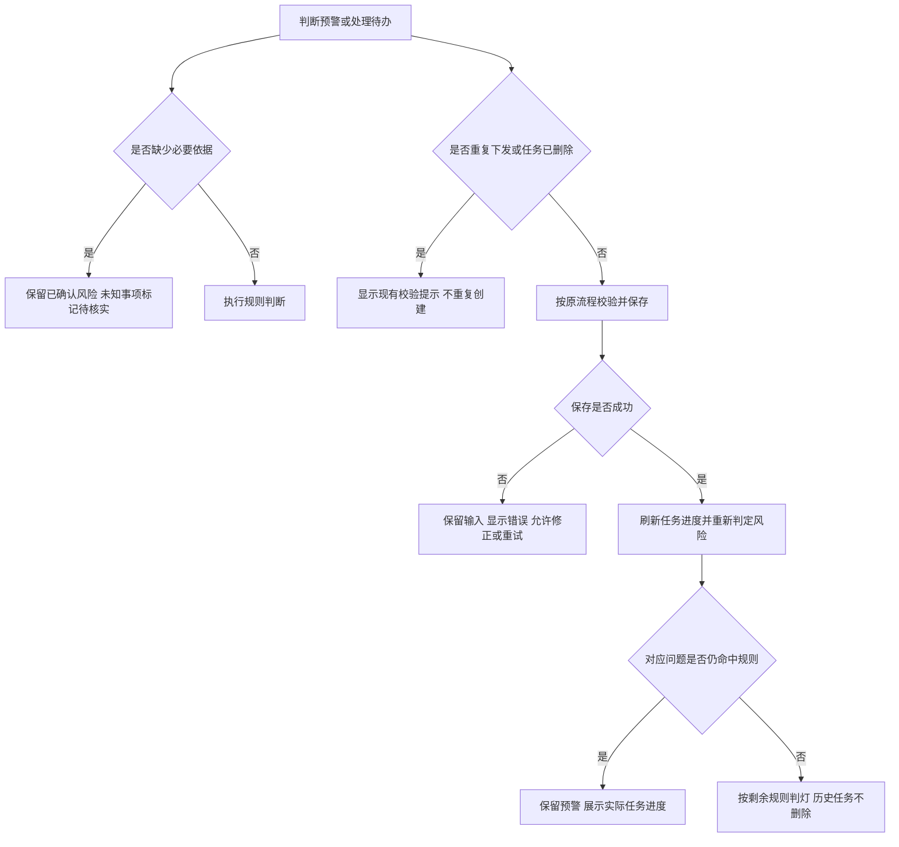

# 关键产品预警与风险待办需求

## 变更信息

| 版本号 | 修订人 | 修订时间 | 主要调整内容 |
| --- | --- | --- | --- |
| V1.0 | 翁宇英 | 2026-10-19 | 复用关键产品预警区和产品风险待办，明确红黄绿判定、统计口径、任务关联及问题解除；保留现有时间筛选与SABC取数规则，不增加橙色。 |

## 1、需求背景

### 1.1 背景

1. 关键产品已支持SABC分级、等级变动、经营指标及库存展示，但矩阵下方预警区仍使用统一利润率10%、总退6%／8%的旧演示规则，未与当前产品分级及退货目标统一。
2. 产品详情已有风险待办，支持AI建议、单条及批量下发、人工新增、负责人和截止日期维护、执行状态更新。预警与任务需要明确关联，避免重复下发，或将任务完成误认为风险解除。

### 1.2 目标

1. 在现有区域识别需要干预的产品，展示触发依据、影响、建议决策及待办进展。
2. 采用已确认的业务口径判灯，不以SABC等级直接替代经营健康判断。
3. 复用已有待办推动部门执行，分别反映任务进度和问题是否仍然存在。

### 1.3 需求范围

| 编号 | 范围 | 本次处理 |
| --- | --- | --- |
| 1 | 矩阵图下方“关键产品预警” | 调整判灯、统计、TOP3及现有产品明细入口。 |
| 2 | 产品详情“风险待办” | 关联预警依据与已有任务，复用执行待办、AI建议和现有操作。 |
| 3 | 时间、业务范围及产品筛选 | 保留近30天、月、季、年及现有筛选和取数规则。 |
| 4 | 产品详情AI总结 | 保留全历史分析及“经营结论、问题分析、部门行动”；区分预警期间与全量分析期间。 |
| 5 | 不在本期范围 | 独立预警中心、增长机会中心、橙色级别、新增考核阈值、周期倒计时、健康评分、预测概率、自动通知、强制下市执行及新的审批流程。 |
| 6 | 现状限制 | 当前为本地原型，样例及本地规则不代表真实公司凭证或已接通大模型服务。固定原型账号不作为生产权限方案；真实数据、账号及通知接入不属于本次页面需求。 |

## 2、权限管理

### 2.1 功能权限及角色管理新增权限树

本次不新增权限节点或授权默认值，复用关键产品查看及现有风险待办的可用操作，不因新增预警来源扩大操作范围。

| 编号 | 入口／操作 | 权限及限制 |
| --- | --- | --- |
| 1 | 查看预警、产品详情、关联待办 | 沿用原入口的查看范围，不在卡片上额外开放任务编辑。 |
| 2 | 下发、批量下发、人工新增、编辑、删除 | 通过原风险待办执行，保留当前操作人、负责人、字段及状态校验。 |
| 3 | AI输出及预警重算 | 仅提供依据和建议，不自行下发、修改任务或执行停售、下市。 |

### 2.2 数据权限页面

本次不新增数据权限页面。公司整体、一类电商、兴趣电商是业务观察范围，不代表新增授权，不得通过范围切换突破原有产品和任务可见范围。

## 3、业务流程

### 3.1 主流程

### 3.2 异常流程

## 4、产品需求

### 4.0 公共规则

#### 4.0.1 G01 时间及业务范围

| 编号 | 数据／动作 | 规则 |
| --- | --- | --- |
| 1 | 经营指标 | 保留现有近30天、月、季、年选择方式，GSV、利润率、销量、总退、已收退使用页面生效的起止日。 |
| 2 | SABC | 保持现状：按所选截止日向前滚动30天取GSV及页面利润率，等级变动比较紧邻的上一个30天窗口。不改成完整自然月考核，不用季／年累计GSV评级。 |
| 3 | 业务范围 | 公司整体、一类电商、兴趣电商沿用当前平台分组；经营指标、退货目标及SABC使用相同范围。 |
| 4 | 库存 | 使用公司最新快照及现有近15日均净销量，不因切换经营期间或电商范围虚构历史库存、分摊公司库存。 |
| 5 | 待办及停售处置 | 使用当前可用的实际状态；逾期以北京时间当前日期判断。查看历史经营期间时，明确标注当前任务状态、库存日期和处置更新时间，不冒充历史状态。 |
| 6 | 进入产品详情 | 经营明细继承预警对应期间和业务范围；AI仍分析全历史资料。预警依据保留自身期间，不被全量分析覆盖。 |
| 7 | 日期说明 | 预警区分别显示经营起止日、评级近30天起止日、库存快照日和待办观察日期，不以一个“本期”代替全部口径。 |

#### 4.0.2 G02 SABC及成本口径

| 等级 | 当前系统条件，两项同时满足 |
| --- | --- |
| S | 近30天GSV＞600万元，页面利润率＞12%。 |
| A | 近30天GSV＞300万元，页面利润率＜12%。 |
| B | 60万元＜近30天GSV＜300万元，页面利润率＞15%。 |
| C | 近30天GSV＜60万元，页面利润率＜12%。 |

1. 沿用各条严格条件，不统一补齐端点和空档。未命中、无有效销量或利润率缺失按现状待分级；待分级不直接触发红灯，也不等于数据完整。
2. 等级升降保留为现有变动展示，不直接改变灯色。A→B、B→A均不能单凭等级顺序认定经营恶化或增长机会。
3. 页面利润率以渠道供价为成本基础，沿用原公式；不以净利润估算或“页面利润率减10个百分点”触发本次预警。
4. 保留S级年度BOM下降5%—8%、A级半年升级、C级一次挽救及三个月无改善下市要求。起算点、改善标准及挽救记录未明确前，不自动倒计时或执行下市，不将C级要求改成必须达到B级。

#### 4.0.3 G03 红黄绿判定

只保留红灯、黄灯、绿灯，不增加橙色或第四个风险等级。分别判断全部规则，再取最高灯色，红灯优先于黄灯。

| 规则编号 | 类型 | 触发条件 | 灯色 | 展示依据 |
| --- | --- | --- | --- | --- |
| R01 | 经营亏损 | 当前经营期间及业务范围的页面利润率有效且＜0。等于0不按亏损判红。 | 红 | 利润率、GSV、期间、业务范围。单个平台亏损不能替代公司整体汇总利润率。 |
| R02 | 停售风险未解除 | 现有违规／品质处置或工作记录明确关联本产品，确认因品质或合规停售，且有当前未解除的状态依据。 | 红 | 原因、产品／SKU／渠道、来源记录、当前状态及更新时间。 |
| Y01 | 总退超目标 | 当前范围总退高于同期间现有总退目标。 | 黄 | 实际值、目标、超出百分点及销量／退货数量。 |
| Y02 | 已收退超目标 | 当前范围已收退高于页面现有目标；当前目标为8%，沿用已有来源。 | 黄 | 实际值、目标、超出百分点及期间。 |
| Y03 | 库存关注 | 命中现有“缺货”“调货”“滞销”任一库存风险标签。 | 黄 | 标签、对应库存及可售天数、计算口径和快照日期。 |
| Y04 | 任务逾期 | 本产品未删除的实际执行待办为待处理／处理中，有效截止日期早于北京时间当前日期。 | 黄 | 事项、负责人／部门、截止日期、逾期天数和当前状态。 |

1. 依据完整且未命中任何已启用规则时为绿灯，文案为“绿灯·当前未触发预警”，不宣称已经证明经营健康或存在增长机会。
2. 仅有历史停售次数、普通下架／整改标签、冻结金额或未核实原因时，不直接触发R02；主动下市、计划清仓不作为品质／合规停售。
3. 有已确认红／黄灯且另有资料缺失时，保留该灯色并提示缺失。无已确认风险但必要依据不足时显示“待核实”，不计入绿灯；待核实为中性说明，不新增风险颜色。
4. 规则空档与数据缺失分开：仅等级未覆盖，不影响其他依据完整的产品独立判灯；未知值不能按0或无风险处理。
5. 本区域停止使用旧利润率10%分界、利润临界2个百分点、总退6%／8%统一判灯线；不取消现有“已收退8%目标”。
6. 其他榜单和指标字色规则不在本次修改范围。明细指标按原偏差规则标红，不代表产品预警必为红灯；产品灯色只按本表判断。

#### 4.0.4 G04 退货及库存计算

1. 总退目标复用现有产品／平台目标；单平台使用对应目标，公司整体或平台组合按同期间各平台销量加权，不能直接平均目标或比率。无有效销量分母时不计算总退及加权目标。
2. 按原始值比较实际与目标，沿用现有浮点容差，不按展示舍入值判定；偏差用“个百分点”。
3. 近15日均净销量＝近15日（销量－总退件数）÷15。我司可售天数、总可售天数沿用对应库存数量÷近15日均净销量的原结果；分母≤0或必要值缺失显示“—”，不补0或显示无穷大。
4. 复用现有标签条件：总可售天数＜30天为缺货；我司可售天数≤7天为调货；我司可售库存＞0且我司可售天数≥60天为滞销。不新增图片中的分级库存阈值。
5. 可售天数不能改称周转天数。标签只表示需核查，不直接批准补货、换供或清仓；建议需结合季品、生命周期、交期、采购排产和放行信息。

#### 4.0.5 G05 计数及排序

1. 按当前筛选后的SPU去重，每款只计一个最终灯色，保留全部命中原因。红、黄、绿及待核实数量互斥，合计等于当前范围产品数；不能因无销量／待分级无法入图而从预警判断中删除。
2. 统计、TOP3和“查看全部”使用同一筛选结果，跟随时间、业务范围、品牌、类目、季品、搜索、等级和等级变动筛选同步更新。
3. TOP3只取红／黄产品，红灯在前；同灯沿用关键产品表格当前有效排序，默认GSV降序。缺失排序值置后，相同原值按SPU码稳定排序；不新增健康分、权重或预测分。
4. 库存为公司级、任务按产品关联，切换业务范围不能复制。各业务范围的统计不能直接相加为公司去重总数。

#### 4.0.6 G06 预警与待办关联

1. 预警表示产品问题，待办表示部门动作。产品灯色不等于待办优先级，任务状态不等于问题状态。
2. 新建议保留产品、触发规则、观察期间／范围及明确来源记录关联。已有任务具有相同问题来源时复用；一个任务可支持多个原因，一个问题可分属多个部门动作，不能只凭同部门或相似标题合并。
3. 筛选切换、重复分析和刷新，不为同一问题重新生成任务。保留已下发、人工编辑、已完成及删除标记；自动分析不覆盖原负责人、期限、优先级、正文及执行记录。
4. 无法明确关联的历史／手工任务保留为本产品上下文，不自动宣称解决了某项风险。Y04可直接引用本产品实际逾期任务，不补造它与其他问题的因果关系。
5. 已关联任务完成但问题仍命中时，显示“任务已完成，问题仍存在”，不自动重复下发。用户可沿用原任务编辑重新打开，或通过现有人工新增入口明确新事项。
6. 下发仍需人工确认负责人和期限，支持现有单条及批量操作。任务优先级仍为红黄绿，人工调整不反向改变产品规则判灯。

#### 4.0.7 G07 问题解除与历史观察

1. 分项重算：R01同一观察范围利润率不再为负；R02有效记录确认限制解除；Y01／Y02回到现有目标内；Y03对应库存标签不再命中；Y04实际任务已完成或按现有操作调整有效期限后不再逾期。
2. 调整期限只影响当前逾期，不代表利润、品质或库存问题已解决。解除一项后按剩余规则取最高灯色；全部不命中且依据完整才能转绿，未知不作为解除。
3. 历史期间亏损不因最新期间盈利被改写。切换期间只是观察结果变化，不能当作整改证明；本期不新增预警历史中心、人工解除按钮或审批状态。
4. 原任务完成日期和历史记录按现有逻辑保留；重新计算预警不删除任务或自动标为完成。

### 4.1 需求列表

| 需求编号 | 需求名称 | 页面／入口 | 说明 | 关联规则／章节 |
| --- | --- | --- | --- | --- |
| F01 | 统一判灯 | 关键产品预警 | 替换旧规则，仅红黄绿，展示依据及待核实信息。 | G01—G05、4.2 |
| F02 | 调整统计与TOP3 | 关键产品预警 | SPU去重、最高级别、具体原因、建议和执行进度。 | G05、4.2 |
| F03 | 复用预警明细 | 查看全部／查看产品 | 查看全部原因，进入原产品详情和风险待办。 | 4.2.2 |
| F04 | 关联现有待办 | 产品详情风险待办 | 不重复下发，不覆盖手工内容，不新建待办系统。 | G06、4.3 |
| F05 | 分离完成与解除 | 预警及风险待办 | 分别展示原任务状态和问题是否仍存在。 | G07、4.3 |
| F06 | 分析及部门动作 | 预警建议、产品AI、待办 | 有依据地解释原因、比较方案，明确部门、对象、动作及交付。 | 4.4 |

### 4.2 关键产品管控

#### 4.2.1 关键产品预警区

##### 4.2.1.1 页面及交互规则说明

| 区域／操作 | 默认状态及行为 | 联动结果 |
| --- | --- | --- |
| 位置 | 沿用矩阵下方关键产品预警，不新增独立中心。 | 保留矩阵、分级表及放大交互。 |
| 灯色统计 | 红灯·优先处理、黄灯·重点跟踪、绿灯·当前未触发预警；有待核实时另列数量文字。 | 点击灯色进入已有产品明细，不显示橙色等级。 |
| 汇总指标 | 保留红灯产品GSV，按当前经营范围去重汇总。旧“利润达标差额·测算”替换为“风险产品关联逾期待办”，统计红／黄产品的未删除实际逾期任务，同任务只计一次。 | 不用统一10%利润缺口推导收益或实际损失。 |
| 优先处理TOP3 | 展示产品身份、最高灯色、主要触发依据、其他原因数量、简明建议及关联任务进度。 | 不足3款按实际展示，不补造产品。 |
| 多项命中 | 主原因先红后黄，同级按R01、R02、Y01—Y04顺序。 | 其他原因在明细完整展示，不全部套用“核查成本与售价”。 |
| 点击产品 | 进入原产品详情，定位风险待办，保留对应期间、范围及全部预警依据。 | 返回恢复原筛选、排序、分页、滚动及矩阵放大状态。 |
| 筛选／重置 | 按G01、G05重算，沿用原分页重置及条件保留规则。 | 不另设隐藏统计范围；不清除实际任务或人工列宽。 |

##### 4.2.1.2 字段说明

| 字段 | 来源及取值 | 展示要求 |
| --- | --- | --- |
| 产品身份 | SPU主数据名称、图片、SPU码、型号。 | 缺失型号显示“—”，不从项目名称补造。 |
| 灯色 | G03结果。 | 颜色和文字同时表达；待核实为中性说明，不用橙色。 |
| 触发依据 | 实际值、目标／条件、日期及来源。 | 比率差用百分点，测算与实际分开。 |
| 关联进度 | G06明确关联的任务及建议。 | 分别显示待下发建议、在办、已完成、逾期数量；建议不计实际在办。 |
| 简明建议 | 本问题及已有方案、执行资料。 | 指出优先决策或核实动作，不编造金额、期限和承诺。 |

##### 4.2.1.3 空状态与失败处理

1. 原范围无产品显示“当前范围暂无产品”；筛选后无结果沿用“暂无符合条件的产品，请调整搜索或筛选”。
2. 无红黄灯且依据完整时，TOP3显示“当前未触发已启用的预警规则”；有待核实时同步显示“部分产品依据不足，待核实”，不能一并宣称正常。
3. 必要依据缺失显示“缺少××，暂无法判定”；未知不填0，规则空档不补等级。
4. 读取失败显示“预警数据加载失败，请重试”，保留筛选及实际任务，不显示全部绿灯；其他来源失败不得清空已确认风险。

#### 4.2.2 关键产品预警产品明细

##### 4.2.2.1 页面及交互规则说明

1. 复用已有“关键产品预警·产品明细”抽屉。灯色卡默认过滤对应灯色；查看全部包含当前范围全部产品，待核实记录以中性文字保留。
2. 保留产品、经营指标、灯色及全部原因，补充明确关联的待办进度。经营原因标所选期间，库存和待办标当前日期，不混算。
3. AI诊断／查看产品进入既有产品详情，查看待办进入本产品风险待办，不另建诊断中心；原趋势入口沿用同一观察范围。
4. 分页、灯色切换及返回按现有抽屉行为，返回保留父层时间、范围、筛选及排序。

### 4.3 产品详情风险待办

#### 4.3.1 执行待办与AI建议

##### 4.3.1.1 页面及交互规则说明

1. 保留执行待办、AI建议两个标签、查询筛选、分页、人工新增及现有表格列，不新建待办系统。
2. 由预警进入时呈现本产品触发依据及关联进度，不隐藏未关联历史任务，也不把它们误记为当前问题已处理；产品、店铺及降本共用任务不复制。
3. 问题描述写清触发事实、来源、判断边界和期间；处理要求写清产品／SKU、实际供应商或单据、部门动作、交付及前置条件。没有批次信息不生成批次。
4. 优先匹配明确关联的已有任务，不为相同事项重复下发；无法明确关联的任务仅作为产品上下文，不按相似标题自动归因。
5. 列表、悬浮和详情使用同一问题描述，不新增摘要功能。保留待办事项240px、问题描述360px默认宽度，以及拖拽、宽度记忆。
6. 优先级继续使用红黄绿，黄灯使用黄色，不用橙色代替；不增加橙色选项、图例、筛选或提示。

##### 4.3.1.2 状态机说明

| 当前状态 | 操作及条件 | 结果 | 对预警的影响 |
| --- | --- | --- | --- |
| 待下发 | 按原规则确认负责人、截止日期、事项及问题描述，单条／批量下发。 | 待处理，记录下发人及日期。 | 不自动解除。 |
| 待处理／处理中 | 通过原详情编辑状态及允许字段。 | 按原流程保存。 | 重算Y04，其他问题独立判断。 |
| 待处理／处理中 | 人工改为已完成。 | 自动记录完成日期，保留既有信息。 | 按G07核对，不直接转绿。 |
| 已完成 | 人工重新改为待处理／处理中。 | 清除当前完成日期，保留原任务身份。 | 重算问题及逾期，不复制任务。 |
| 已下发任务 | 经原流程确认删除。 | 保留既有删除标记，不计有效任务。 | 不解除经营、品质和库存问题，不自动重建同一建议。 |

##### 4.3.1.3 操作及校验

1. 沿用原提示：“请选择当前操作人”“请选择负责人”“请填写待办事项和问题描述”“请选择截止日期”“截止日期不能早于今天”“请选择优先级”；下发及新增按北京时间日期校验。
2. 重复下发沿用“该建议已下发，请刷新列表”，任务已删除沿用“待办已删除，请刷新列表”，不重复创建或覆盖。
3. 批量下发沿用全部校验通过后统一保存，错误不新增部分任务；保留选择及输入，允许修正。取消／关闭沿用原草稿与焦点恢复规则。
4. 保存失败保留输入和原任务，显示错误并允许重试；成功后刷新列表及关联进度，不自动修改其他任务或发送通知。
5. 不新增导入、批量修改、验收审批和通知，不改变现有任务类型及账号接入方式。

### 4.4 AI分析与部门行动

#### 4.4.1 经营分析边界

1. 规则负责触发及判灯，AI解释原因、比较相关方案及提出部门动作，不自行改门槛或覆盖规则结果。
2. 单品保持经营结论、问题分析、部门行动三部分；预警区只展示简明建议，完整分析在原产品详情。不新增健康分、降级概率和预测完成时间。
3. 区分观察期与全历史，累计亏损不替代所选期间判灯，最新改善不抹除历史事实。
4. 区分事实、人员陈述、推测、测算和建议；推测标“推测”。方案、费用和承诺从已有日周报、待办或会议纪要提取，不假定采购／质检基础单据包含方案结论。
5. 继续经营、迭代、降本、备货及下市均按证据比较，不因任务完成、等级变化或销量增长直接认定有效。

#### 4.4.2 部门动作要求

| 问题 | 牵头及必要协同 | 动作要求 |
| --- | --- | --- |
| 利润为负 | 产品中心，协同采购部、财务。 | 按产品和SKU比较渠道成本改善、采购附加条件、整改与退出成本，提出新增投入边界。 |
| 品质／合规停售 | 品质原因由品质中心牵头，用户中心及实际相关部门协同；非品质合规按记录实际责任方处理。 | 核实实际违规／检验／工作记录、影响对象、未解除条件及需提交的证据，不按历史次数推断限制。 |
| 退货超目标 | 品质中心、用户中心，确认技术原因后研发中心参与。 | 对照渠道、SKU、退货订单、评价及样品复现问题，提交原因、范围及验证结果，不直接认定设计缺陷。 |
| 库存关注 | 采购部落实必要采购动作，计划部核定需求供需，发货部核对可售状态，产品中心判断保留或退出。 | 对照SKU库存、未交采购、排产、季节窗口明确保留、延期、减量或调拨安排，不无依据要求补货。 |
| 任务逾期 | 原负责人及部门；跨部门依赖由项目部协调。 | 明确逾期事项、阻塞、经营影响、下一交付及需决策内容，不只写加强跟进。 |

1. 不机械安排全部部门，动作写清实际对象、操作及交付；不虚构供应商、批次、SKU或单据编号。
2. 价格、投放、促销及清仓渠道仍由运营决定，产品链提出产品和供应方案。
3. AI正文沿用蓝色决策、红色风险、深紫色关注及部门名称；预警灯色为红黄绿。两者语义不同，均不增加橙色。

## 5、验收标准

| 验收编号 | 关联需求／规则 | 前置条件及操作 | 可观察的结果 |
| --- | --- | --- | --- |
| A01 | F01、G03 | 查看预警、待办优先级选项。 | 只有红黄绿，不出现橙色或以橙代黄；无新增独立中心。 |
| A02 | G01、G02 | 切换近30天、月季年和业务范围。 | 经营指标按所选期间，SABC仍取截止日前30天，库存仍取最新快照，各自日期明确。 |
| A03 | G02 | 测试规则空档、边界、无销量及缺失值。 | 逐条匹配现有严格条件，不补齐规则或伪造C级；待分级不直接红。 |
| A04 | R01 | 页面利润率为负、0、正，另有不同净利估算。 | 仅有效负页面利润率触发R01，不用净利估算和10%线。 |
| A05 | R02 | 提供历史下架、主动下市、原因不明整改、已确认未解除品质停售记录。 | 只有最后一项触发R02，原因或状态不足待核实。 |
| A06 | Y01、Y02、G04 | 各平台不同销量和目标，实际值低于／等于／高于目标。 | 复用平台及加权目标，只有超出才黄；已收退沿用8%，不使用旧总退6%／8%。 |
| A07 | Y03、G04 | 测试总可售30天、我司7天及60天边界、库存0、净销量≤0。 | 按原严格／含等号条件判标签，无分母显示“—”，不补0或制造无穷大。 |
| A08 | Y04 | 期限为昨天、今天及未来，任务为各状态及已删除。 | 仅未删除实际任务的待处理／处理中且早于今天时黄，到期当天不逾期。 |
| A09 | G03、G05 | 同SPU多平台、多问题同时命中。 | 当前范围只计一款，取最高级，保留所有原因；跨范围不能直接相加。 |
| A10 | G03 | 已确认风险兼缺失；无确认风险但缺失；完整且无风险。 | 分别保留风险并提示、待核实、绿灯；缺失不按0。 |
| A11 | F02、G05 | 切换搜索及全部现有筛选、排序。 | 统计／TOP3／明细同范围，红优先，同灯按当前排序，不足3款不补造。 |
| A12 | F03、4.2.2 | 从TOP3或明细进产品详情后返回。 | 继承经营范围和期间，AI仍全量，父层筛选、分页及放大状态恢复。 |
| A13 | G06 | 重复分析、筛选、刷新、下发，另有同部门不同来源任务。 | 同问题不重复创建，人工内容不覆盖，不同问题不因同部门误合并。 |
| A14 | F04、4.3 | 单条／批量下发遗漏负责人或填写过去日期，并取消。 | 原提示有效，失败不部分新增，取消不新增，输入及原任务保留。 |
| A15 | F05、G07 | 任务完成但利润仍负、退货仍超标或停售未解除。 | 任务已完成，预警保留，显示“任务已完成，问题仍存在”。 |
| A16 | G07 | 红灯条件解除但仍有黄，再解除全部，另将依据改为未知。 | 分别变黄、转绿、待核实；未知不算解除，历史任务不删除。 |
| A17 | G07 | 延长期限、删除任务或切到最新盈利期间。 | 只影响对应逾期／观察结果，不解除其他规则，不改写历史。 |
| A18 | 4.2、4.3 | 来源读取或保存失败。 | 保留筛选、输入和任务，显示失败，不伪装成全部绿灯或保存成功。 |
| A19 | 2、4.4 | 尝试由预警入口绕过原任务校验，或让AI自动下发、停售、换负责人。 | 不扩大授权，不绕过原校验，AI只输出建议。 |
| A20 | 4.3、4.4 | 检查问题描述、动作、颜色，拖拽列宽后刷新。 | 同一描述复用；动作具体且不虚构批次；AI蓝红深紫；保留默认240／360px及列宽记忆。 |
